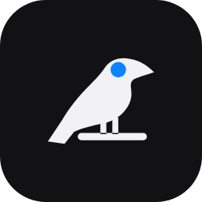
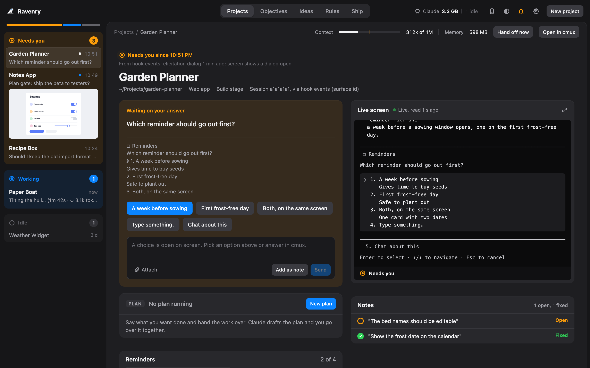
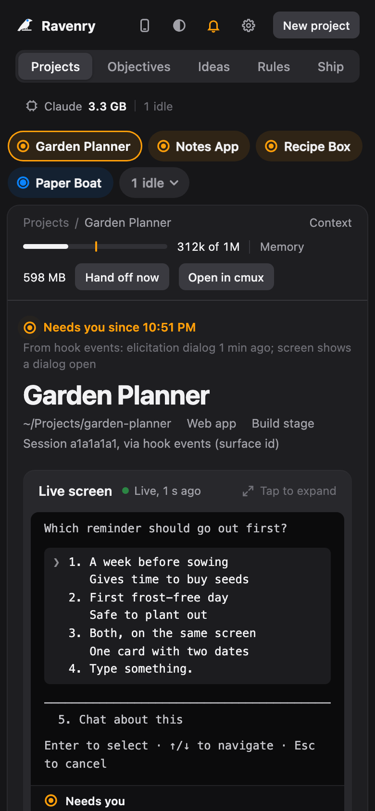

<p align="center"></p>

# Ravenry

One local board for every Claude Code session on your Mac: see which project needs you, answer it from the board, and keep a short brief for each project.



## Why Ravenry?

I built Ravenry while running many Claude Code sessions at once, across all my projects, for example while building [Antics](https://antics.gg). Following them all was the hard part: finding the tab that was waiting on me, answering the same kind of question again and again, and telling each new session what the last one already knew.

Ravenry puts every session on one page, sorted by what needs you. It pairs with [Agent Flow](https://github.com/patoles/agent-flow): Agent Flow shows what one session is doing inside, Ravenry follows all your sessions across all your projects.

- **Know where to look**: the projects waiting on you are at the top, with their question.
- **Answer without hunting**: reply, pick a menu option or attach a file from the board.
- **Stop repeating yourself**: briefs, hand-offs and rule suggestions carry what you said to the next session.
- **Step away**: follow and answer from your phone on your home Wi-Fi, with alerts when a project needs you.

## Features

- **One board for every session**: projects grouped by Needs you, Working, Waiting on others and Idle, with each session's context fill and memory.
- **Live screen**: each session's terminal, read live, with a full screen view.
- **Answer from the board**: send a message, pick a menu option (Yes, No, a choice), attach files, open the session's tab or close idle ones.
- **Hand-off at half context**: a session past half its context writes a hand-off at its next clean point, and a fresh session picks it up.
- **Plans with gates**: hand work over as a plan with steps; it runs on its own and stops at the gates you set.
- **Project briefs and a pictures gallery**: a short brief per project (goal, plan, next step, notes) and the last pictures each session showed you.
- **Rule suggestions**: corrections you keep typing in your sessions, offered as rules for your CLAUDE.md (off until you turn them on).
- **Phone access**: the whole board on your phone on your home Wi-Fi, through a QR code.
- **Phone alerts**: a message when a project starts needing you, through Telegram, Discord, Slack or ntfy, plus Mac notifications.
- **Terminals**: answer sessions in cmux and iTerm2; sessions in any other terminal are watch only.

## Getting Started

```sh
npm i -g ravenry-app
ravenry
```

The first `ravenry` runs `ravenry setup`, which:

1. Checks your Mac: macOS, Node, `claude` on your PATH, and which terminal you are in.
2. In iTerm2, offers to set up a small Python folder so the board can pick menu options.
3. Shows the exact lines it would add to `~/.claude/settings.json` (two hooks) and asks before writing anything (`[y/N]`). It backs the file up first and touches nothing else.
4. Asks whether to turn on rule suggestions (off unless you say yes).

Then the board starts on http://localhost:4600 and its page opens. A new board is empty: start `claude` in a project's folder and it shows up within a few seconds. Each folder becomes a project.

`npx ravenry-app` works for a first look, but setup does not install the hooks from it: npx keeps its copy in a cache it may clear, and a hook needs a path that stays put. Install it globally to keep it.

### What setup changes on your Mac

**`~/.claude/settings.json`**, backed up first (`settings.json.bak-<time>` next to it). Setup adds two hooks; your other hooks and settings stay exactly as they are:

| Event | Command |
| --- | --- |
| SessionStart, SessionEnd, UserPromptSubmit, Notification, Stop | `<node> <ravenry>/hooks/events.mjs` |
| Stop | `<node> <ravenry>/hooks/handoff-stop.mjs` |

`<node>` is your Node and `<ravenry>` the installed package, both as full paths (setup prints them). The events hook writes one line per event to `~/.ravenry/events/` and tells the board; the Stop hook asks a session past half context to write a hand-off and start fresh at its next clean point (Settings on the board turns that off). Neither ever blocks a session. If you change Node versions, `ravenry doctor` says the hooks are stale and `ravenry setup` points them at the new one.

**`~/.ravenry/`**, the data folder: your projects (`projects.json`), briefs, ideas, hand-offs, hook events (kept 14 days), phone access and alert settings.

**Only if you say yes in iTerm2**: `~/.ravenry/iterm2-py`, a small Python folder with iTerm2's package. The board tab's profile goes in `~/Library/Application Support/iTerm2/DynamicProfiles/ravenry.json`.

Nothing else: no login item, no background service. The board runs while its terminal is open.

### Phone access

The phone button at the top of the board shows a QR code. A phone on the same Wi-Fi scans it and gets the whole board, live.



It works on your home network only: the board answers to the Mac itself and to your local Wi-Fi address, each phone needs the key in the code, and New key signs every phone out. The first time, macOS may ask whether Node may accept incoming connections; allow it for phones to reach the board.

## Terminals

Where you start `ravenry` decides where its page opens:

- **In a cmux tab**: the board runs in that tab and its page opens in a cmux browser pane above it.
- **In an iTerm2 tab**: a "Ravenry" tab opens with the page on top and the board's terminal below.
- **Anywhere else**: the board runs in your terminal and the page opens in your browser. Keep the window open; Ctrl+C stops the board.

In cmux and [iTerm2](https://iterm2.com) (free) the board reads each session's screen and types into it. iTerm2 needs its Python API on for menu options (iTerm2 > Settings > General > Magic > Enable Python API), and macOS may ask once to let the board control iTerm2.

Sessions in any other terminal (Terminal, VS Code, Ghostty, Warp, tmux...) are watch only: you see their state, questions and context, and answer them in their own window.

## Commands

| Command | Description |
| --- | --- |
| `ravenry` | Start the board on http://localhost:4600 and open it (runs setup the first time) |
| `ravenry setup` | Check this Mac and install Ravenry's Claude Code hooks |
| `ravenry doctor` | Say what works and what does not, and what to do about each |
| `ravenry uninstall` | Take Ravenry's hooks out of `settings.json` (backup first) |
| `ravenry uninstall --purge` | Also delete `~/.ravenry` |
| `ravenry --version` | Print the version |
| `ravenry help` | List the commands |

Options: `--yes` answers yes in setup and uninstall (for scripts), `--no-open` starts the board without opening the page, and `PORT=4700 ravenry` runs it on another port.

To remove Ravenry completely: `ravenry uninstall --purge`, then `npm rm -g ravenry`.

## Requirements

- macOS
- [Node.js](https://nodejs.org/) 22 or newer
- [Claude Code](https://claude.com/claude-code) (`claude` on your PATH)
- To answer sessions from the board: cmux or [iTerm2](https://iterm2.com)

Playwright is optional, only for the mockup pictures of an idea: `npm i -g playwright && npx playwright install chromium`.

## Development

```sh
git clone https://github.com/patoles/ravenry.git
cd ravenry
npm ci
npx playwright install chromium   # for the headless tests
npm start                         # the board from this checkout, on :4600
```

The board has no runtime dependencies and no build step: `server/` is plain Node and `public/` is the page. Each test is a plain script, for example `node tools/gallery-test.mjs`; every test keeps its data in the repo's `.tmp/` and runs its own board on a test port, never your real one. `npm run pack:check` proves the npm package from its tarball in a scratch install, and `node tools/readme-shot.mjs` redraws this README's screenshots from a made-up demo board. [docs/DEVELOPING.md](docs/DEVELOPING.md) describes how the board works and lists every test; [CONTRIBUTING.md](CONTRIBUTING.md) says how to send a change.

## Privacy

Ravenry has no telemetry of any kind. Everything stays on your Mac: the board reads your Claude Code transcripts and terminal screens locally and keeps its data in `~/.ravenry`. Two things can leave the Mac, and only when you set them up:

- **Phone alerts** (Telegram, Discord, Slack or ntfy): a short message, sent when a project starts needing you.
- **Features that ask Claude** (the Ideas thread, mockups, Plans, rule suggestions) run `claude -p` on your own Claude login, like any Claude Code use. Rule suggestions are off unless you turn them on; when on, once a day they send the messages you typed in your sessions to Claude to find the corrections you keep repeating.

## Troubleshooting

`ravenry doctor` says what works and what does not, in plain words, and what to do about each.

- **No sessions show up**: run `ravenry doctor`. If the hooks are missing, run `ravenry setup`. Sessions started before setup report after their next restart.
- **"Hooks are stale"**: Node or Ravenry moved (a new Node version, a reinstall). `ravenry setup` points them at the current copy.
- **The port is taken**: `PORT=4700 ravenry`.
- **iTerm2 sessions are watch only**: start `ravenry` from an iTerm2 tab, and allow the Automation prompt (System Settings > Privacy & Security > Automation).
- **Mockup pictures fail on an idea**: they need Playwright (see Requirements).

## Author

Created by [Simon Patole](https://github.com/patoles), for [Antics](https://antics.gg).

## License

Apache 2.0. See [LICENSE](LICENSE) and [NOTICE](NOTICE); changes are in [CHANGELOG.md](CHANGELOG.md).

The name "Ravenry" and its logo are trademarks of Simon Patole. See [TRADEMARK.md](TRADEMARK.md) for usage guidelines.
