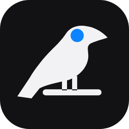
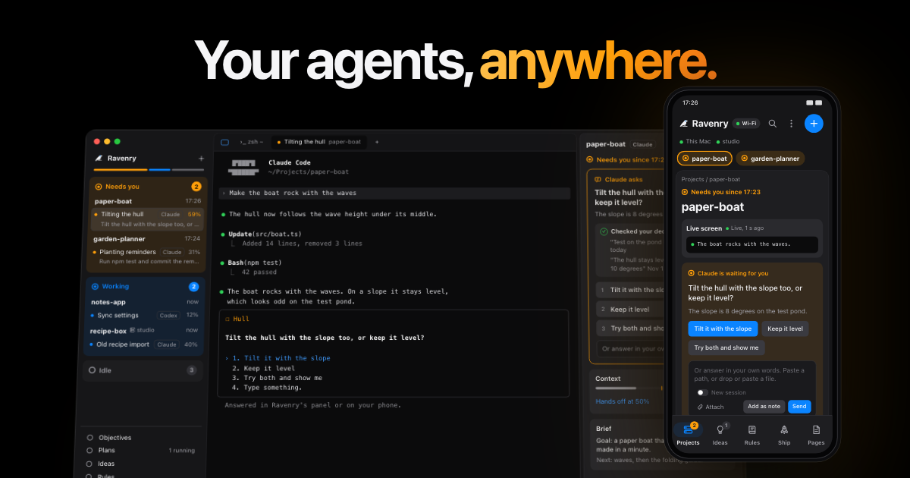

# Ravenry

The open-source terminal for Claude Code, Codex, OpenCode and Antigravity CLI.

Ravenry runs your coding agents in real terminals, on your Mac and on your
other machines over ssh, and puts every session on one board, sorted by
what needs you. When an agent needs a choice, a go-ahead or a secret, it
stops and asks, and the question shows up on your Mac and on your phone at
the same time. Answer from either one.

- **A real terminal.** Native on the Mac (Swift and Metal), with tabs and
  splits. Sessions keep running when you quit or update the app.
- **One board.** Every session, grouped as Needs you, Working and Idle,
  with its live screen.
- **Your phone.** The Android and iPhone apps show every project, start new
  sessions and answer from the notification.
- **Your machines.** Linux and Mac machines over ssh, on the same board.

A short video: [docs/media/ravenry-30s.mp4](docs/media/ravenry-30s.mp4).

## Download

Ravenry is in an early test: get the Mac app (Apple silicon, macOS 13 or
later), the Android app and the iPhone and iPad app from
**https://patoles.github.io/ravenry/**.
The Mac app updates itself. It works with Claude Code, Codex, OpenCode and
Antigravity CLI, installed and signed in.

## Build from source

Each app's README has the details. You need Node 22 or later for all of
them, and `npm ci` at the root of the repository first.

| What | Needs | Build |
| --- | --- | --- |
| `ravenryd`, the daemon ([daemon/](daemon/README.md)) | Go, Zig 0.17 or later, git | `cd daemon && make && make test` |
| The Mac app ([apps/macos/](apps/macos/README.md)) | macOS 13 or later, Xcode, XcodeGen, Go, Zig | `cd apps/macos && scripts/build.sh` |
| The Linux desktop app ([apps/desktop/](apps/desktop/README.md)) | Linux or macOS, Go, Zig | `npm run desktop` to run it; `npm --workspace @ravenry/desktop run pack -- --linux` for an AppImage and a .deb |
| The Android app ([apps/android/](apps/android/README.md)) | Java 17, the Android SDK | `cd apps/android && ./gradlew assembleDebug` |
| The iPhone and iPad app ([apps/ios/](apps/ios/README.md)) | Xcode, XcodeGen | `cd apps/ios && scripts/build.sh` (the simulator) |
| The hub, the board's server ([hub/](hub/README.md)) | macOS | `cd hub && npm ci && npm start` (http://localhost:4600) |

## The repository

| Folder | What |
| --- | --- |
| `daemon/` | `ravenryd`, the Go daemon on every machine: terminals, screen state through libghostty-vt, waits and input for agents, the protocol server, and its command line. |
| `hub/` | The hub, in Node: the board and the always-on server every app talks to. |
| `apps/macos/` | The native Mac app, Swift and AppKit, drawing the daemon's screen with its own Metal renderer. |
| `apps/desktop/` | The Electron desktop app, for Linux. |
| `apps/android/`, `apps/ios/` | The phone apps: thin shells around the phone board. |
| `apps/phone/` | The phone board's own screens, shared by the phone apps. |
| `shared/` | What every client shares: words, icons, themes, design tokens, settings. |
| `packages/` | The protocol spec, the client libraries and the page format, for plugins and other clients. |
| `site/` | The download page. |
| `docs/` | [ARCHITECTURE.md](docs/ARCHITECTURE.md), [FEATURES.md](docs/FEATURES.md) (every feature and where each app stands), [PHONE.md](docs/PHONE.md), [RENDERING.md](docs/RENDERING.md), [PUBLISHING.md](docs/PUBLISHING.md). |
| `tools/` | The repository's checks: the personal-data audit, the feature list check, the third-party notices. |

## Contributing

Issues and pull requests are welcome: [CONTRIBUTING.md](CONTRIBUTING.md)
says how. Report a security problem privately, as
[SECURITY.md](SECURITY.md) says.

## Licence

Ravenry is free software. Everything outside `packages/` is under the GNU
General Public License, version 3 only ([LICENSE](LICENSE)); `packages/` is
under the Apache License, Version 2.0 ([packages/LICENSE](packages/LICENSE)),
so plugins and clients written against it can use any licence. A
commercial licence for the GPL parts is available from the copyright
holder. [LICENSING.md](LICENSING.md) has the details,
[THIRD_PARTY_NOTICES.txt](THIRD_PARTY_NOTICES.txt) lists the projects the
apps include, and [TRADEMARK.md](TRADEMARK.md) covers the name and logo.
